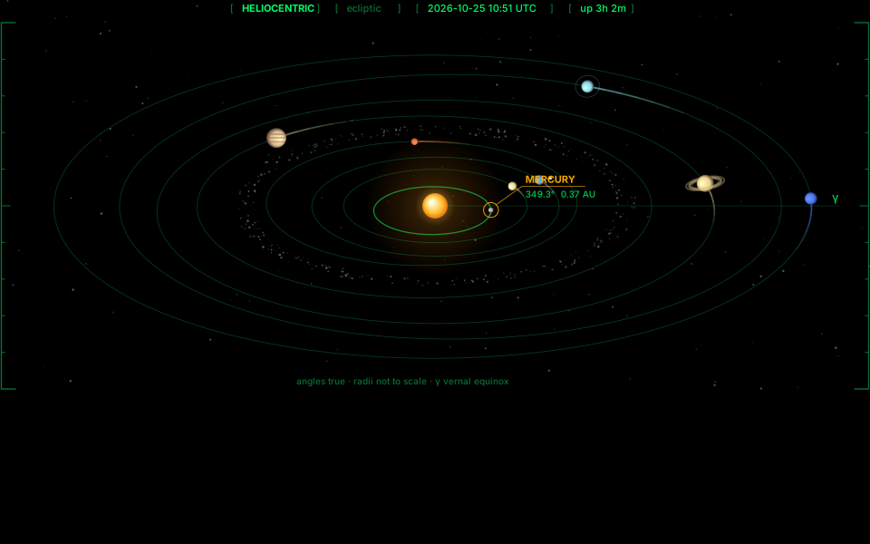
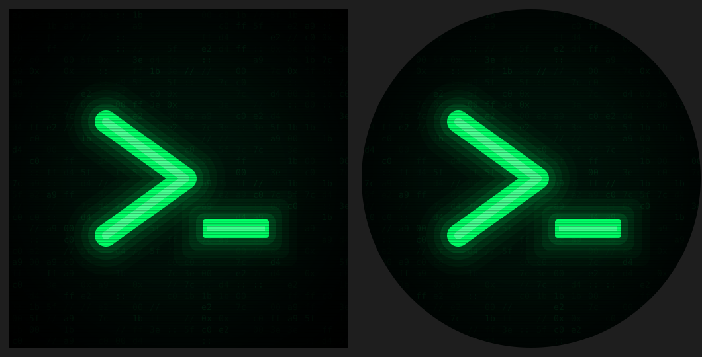

# ubuntu-setup

A staged, idempotent setup for **Ubuntu 26.04 LTS (GNOME 50, Wayland)** that turns a fresh install into a minimal, black-and-green, tuned workstation — and snapshots the result so it can be restored on any machine.

<p align="center">
  <br>
  
  
</p>

## What it does

| Stage | Command | What |
|---|---|---|
| 1 | `./ubuntu-setup.sh 1` | Base packages, firmware, Flathub, UFW. **zram** swap + sysctl tuned for it, kdump/apport removed, boot-blocking services off, journald capped. → *reboot* |
| 2 | `./ubuntu-setup.sh 2` | Dark theme, Inter + JetBrains Mono, GNOME behaviour and keybindings, auto-hiding dock, no desktop icons, **Just Perfection** + **Vitals** in a stripped top bar. → *log out/in* |
| 3 | `./ubuntu-setup.sh 3` | **Ghostty** + zsh + starship + modern CLI (eza, bat, rg, fd, fzf, zoxide, delta, btop, yazi), Nautilus tweaks, Firefox as a real `.deb` (Mozilla repo), VS Code, TeX Live, Obsidian. → *log out/in* |
| 6 | `./ubuntu-setup.sh 6` | **Proton VPN** (CLI, Switzerland default, advanced kill switch, auto-connect at login) and **TLP** + tlp-pd with 75–80 % charge thresholds. |
| 7 | `./ubuntu-setup.sh 7` | Look: black GDM login screen with green accent, `>_` avatar, **Plymouth** boot splash that types `booting` / `rebooting` / `shutting down` with a blinking cursor. |
| 8 | `./ubuntu-setup.sh 8` | Dev toolchain: **uv** (Python), **mise** (Node LTS, pnpm, Go, Bun, doctl, gh, vercel), **elan** (Lean 4), **pixi** (+ optional SageMath), **Podman**. |
| 9 | `./ubuntu-setup.sh 9` | **VS Code** profiles *LaTeX*, *Coding*, *ML Code*, *Lean* — curated extensions + settings from `vscode/`, extras removed; containers via Podman. |
| 4 | `./ubuntu-setup.sh 4` | Verify the system, then **snapshot** everything into this repo (sanitised, secret-scanned) and commit. |
| 5 | `./ubuntu-setup.sh 5` | **Restore** from this repo on a fresh install (also runs 7, 8, 9). |

Also included: two **Conky** desktop widgets (hardware vitals with ASCII bars, and a Cairo orrery computing real planet positions from JPL mean elements, ~5 % of one core at 5 fps, 1 fps on battery), a **fastfetch** welcome card, an **rclone** Proton Drive mount as a systemd user service.

`ubuntu-26.04-setup.md` is the full written guide: what every step does and why, and what is deliberately *not* done.

## Use

Fresh Ubuntu 26.04 install:

```bash
git clone https://github.com/twooka/ubuntu-setup ~/dotfiles
cd ~/dotfiles && chmod +x ubuntu-setup.sh

./ubuntu-setup.sh 1   # reboot
./ubuntu-setup.sh 2   # log out / in
./ubuntu-setup.sh 3   # log out / in
./ubuntu-setup.sh 5   # restore configs, dev tools, VS Code, look
./ubuntu-setup.sh 6   # VPN sign-in + TLP, then reboot
```

Run any stage on its own; all are idempotent. Run as your user, not root (it uses `sudo` where needed). Stages 6–9 download a lot — with the advanced kill switch on, keep the VPN connected.

After changing anything on the machine:

```bash
~/dotfiles/ubuntu-setup.sh 4 && git -C ~/dotfiles push
```

## Layout

```
ubuntu-setup.sh            the staged script
ubuntu-26.04-setup.md      the guide
gnome.dconf                GNOME + extension settings (dconf dump, personal state stripped)
extensions.txt             enabled GNOME Shell extensions
apt-manual.txt flatpak.txt uv-tools.txt     package lists used by restore
config/                    ghostty, conky, fastfetch, autostart, mise, uv, environment.d, systemd user units
etc/                       sysctl, zram, journald, TLP, apt sources/pins, GDM login-screen settings
vscode/                    <profile>.extensions.txt + <profile>.settings.json for each VS Code profile
assets/                    avatar, boot emblem, Plymouth "prompt" theme
```

## Privacy

Snapshots are made to be publishable:

- `gnome.dconf` is filtered (app grid, recent folders, file-chooser history, online-account IDs, window geometry removed).
- Git identity is not stored: `.gitconfig` includes `~/.gitconfig.local`, which restore creates and which is git-ignored. Stage 4 refuses to commit with a non-`noreply` address.
- Only systemd user units managed by this setup are saved; Nautilus bookmarks are not.
- `rclone.conf` (credentials) is never copied — only remote names.
- If `gitleaks` is installed (`mise use -g gitleaks`), stage 4 scans before every commit and aborts on findings.

## Adapting it

- Paths are written as `$HOME`; restore rewrites any absolute home paths in the Conky/autostart files.
- VPN default country: `--country CH` in stage 6 and the `vpn` alias.
- Charge thresholds: `etc/01-local.conf`.
- Orrery size / frame rate: `CW`, `CH`, `WARP` in `config/conky/orrery2.lua`, `update_interval` in `config/conky/hud.conf`.
- VS Code: edit `vscode/*.txt|json`, run stage 9.

## Caveats

- Targets GNOME 50 on 26.04; extensions are pinned to what that release supports.
- rclone's Proton Drive backend is unofficial; Proton may rate-limit or reject logins.
- No supported Linux driver exists for the Goodix `27c6:538d` fingerprint reader.

## License

MIT — see [LICENSE](LICENSE).
